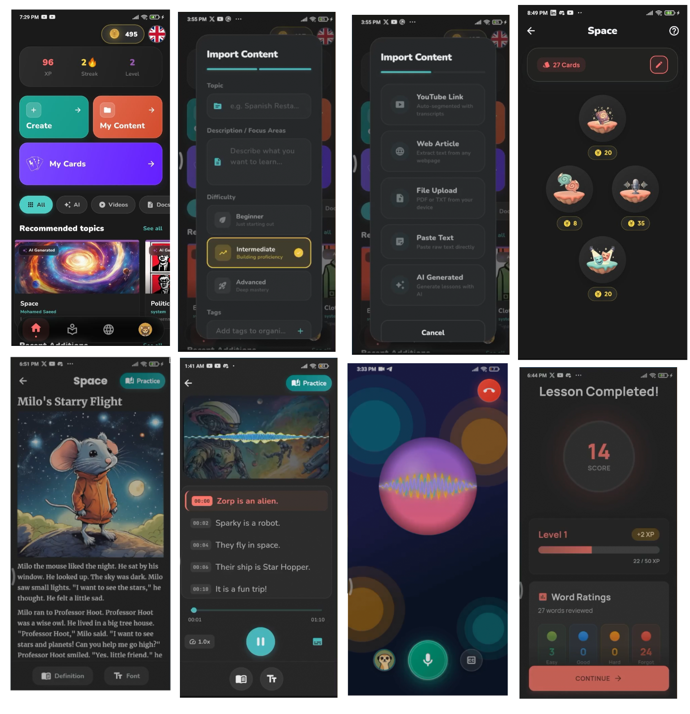

# Badya — Open-Source AI Language Learning Platform

[](LICENSE)
[](https://flutter.dev)
[](https://www.python.org)
[](https://fastapi.tiangolo.com)

**Badya** is an open-source, AI-powered language learning platform built with **Flutter** and **Python (FastAPI + Google ADK)**. It replaces rote memorization with immersive practice: interactive illustrated stories, real-time voice conversations, situational role-play, and a SuperMemo SM-2 Spaced Repetition System (SRS).



---

## Architecture Overview

```text
                      ┌────────────────────────────────┐
                      │    Badya Flutter Client App    │
                      │  (Mobile, Tablet, Desktop, Web)│
                      └──────────────┬─────────────────┘
                                     │
           ┌─────────────────────────┼─────────────────────────┐
           │ REST / SSE / WebSockets │                         │ Firebase SDK
           ▼                         ▼                         ▼
┌────────────────────────┐  ┌─────────────────┐  ┌───────────────────────────┐
│ FastAPI AI Backend     │  │ Real-time Voice │  │ Firebase Ecosystem        │
│ • Story Agent          │  │ Client & Audio  │  │ • Cloud Firestore         │
│ • Word Smith (SRS)     │  │ Stream Engine   │  │ • Firebase Authentication │
│ • Role Master Agent    │  └─────────────────┘  │ • Firebase Storage        │
│ • Echo Chamber (Audio) │                       │ • Cloud Messaging (FCM)   │
│ • Corrector Agent      │                       └───────────────────────────┘
│ • Session Analyzer     │
└──────────┬─────────────┘
           │
           ▼
┌────────────────────────────────┐
│ LLM & Media Services           │
│ • Google Gemini (ADK Agents)   │
│ • Stability AI (Illustrations) │
│ • Google Cloud TTS             │
└────────────────────────────────┘
```

---

## Key Features

- **4 Learning Tracks per Topic**:
  - **Story Weaver**: Real-time SSE-streamed interactive stories with AI-generated illustrations and tap-to-define dictionary lookups.
  - **Word Smith**: SRS-aware vocabulary drills (teach mode for new words, quiz mode for due words).
  - **Role Master**: Dynamic real-world role-play scenarios (job interviews, ordering food, travel) with a parallel non-intrusive corrector agent.
  - **Echo Chamber**: Listening & speaking comprehension with TTS audio stories and voice responses.
- **Spaced Repetition System (SM-2)**: Full SuperMemo SM-2 implementation (`Frontend/badya_app/lib/models/word_review_state.dart`) tracking easiness factor, intervals, and mastery.
- **Content Import Pipeline**: Convert web articles and YouTube videos into segmented lessons with extracted vocabulary (`AI/importer/`).
- **Detailed Page & UX Guide**: See [docs/pages_ux_and_technical_guide.md](docs/pages_ux_and_technical_guide.md) for a screen-by-screen breakdown and technical mapping.

---

## Repository Structure

```text
Badya-OSS/
├── AI/                          # Python FastAPI Backend & Multi-Agent System
│   ├── analyze_agent/           # Post-session scoring & word-level SRS feedback
│   ├── corrector_agent/         # Parallel non-intrusive grammar/nuance corrector
│   ├── definition_agent/        # Contextual word definitions
│   ├── role_master_agent/       # Situational role-play dialogue
│   ├── story_agent/             # Interactive story & illustration generator
│   ├── video_agent/             # Echo Chamber listening & speaking exercises
│   ├── voice_chat/              # Real-time WebSocket voice conversation
│   ├── word_smith_agent/        # SRS-driven vocabulary practice
│   ├── importer/                # Article & YouTube content extractor
│   ├── main.py                  # FastAPI server entrypoint
│   ├── deploy_to_cloud_run.sh   # Production Cloud Run deployment script
│   ├── Dockerfile               # Container image definition
│   └── requirements.txt         # Python dependencies
├── Frontend/
│   └── badya_app/               # Primary Flutter application (Android/iOS/Web/Desktop)
├── docs/
│   ├── pages_ux_and_technical_guide.md  # Page-by-page UX & technical documentation
│   └── screenshots/             # UI screenshots
├── CONTRIBUTING.md              # Contribution guidelines
├── SECURITY.md                  # Security & vulnerability disclosure policy
└── LICENSE                      # Apache 2.0 License
```

---

## Setup & Installation

Choose the setup path that matches your goal:

### Option A: Local Development & Testing (No Cloud Deployment Required)

If you want to run and test Badya locally on your machine or emulator, **you do not need Google Cloud Run, Secret Manager, or Vertex AI**. You only need:
- **Python 3.11+** & **Flutter 3.22+**
- A **Google Gemini API Key** (from Google AI Studio)
- A **Stability AI API Key** (optional, for story illustrations)
- A **Firebase project** (free Spark plan works for Auth + Firestore)

#### 1. Start the Local AI Backend
```bash
cd AI
python -m venv .venv
source .venv/bin/activate  # On Windows: .venv\Scripts\activate
pip install -r requirements.txt

cp .env.example .env
# Edit .env and set GOOGLE_API_KEY (for local Gemini AI Studio) and STABILITY_API_KEY
# Or, for Vertex AI / Google Cloud instead of GOOGLE_API_KEY, uncomment:
#   GOOGLE_GENAI_USE_ENTERPRISE=TRUE
#   GOOGLE_CLOUD_PROJECT=badya-f1af2
#   GOOGLE_CLOUD_LOCATION=us-central1

# Optional: if using Firebase Admin locally, add your serviceAccountKey.json
cp serviceAccountKey.json.example serviceAccountKey.json

uvicorn main:app --host 0.0.0.0 --port 8000 --reload
```

#### 2. Run the Flutter App

##### 2a. Local on Emulator (Android / iOS) — No Cloud or Auth Needed
Run in **Local Guest Mode** (`LOCAL_MODE=true`) to bypass Firebase Auth and load predefined system topics from `assets/seed_topics.json`:
```bash
cd Frontend/badya_app
flutter pub get

# The Android Gradle plugin requires google-services.json at build time.
# Copy the placeholder template (Firebase is not used at runtime in LOCAL_MODE):
cp android/app/google-services.json.example android/app/google-services.json

# Android Emulator automatically routes 10.0.2.2:8000 to your host machine
# iOS Simulator automatically routes localhost:8000 to your host machine
flutter run --dart-define=LOCAL_MODE=true
```

##### 2b. Local on a Real Physical Phone
1. Ensure your phone and development machine are on the **same Wi-Fi network**.
2. Find your machine's local LAN IP (e.g., `192.168.1.50` via `ip a` or `ipconfig`).
3. Pass `API_HOST_IP` along with `LOCAL_MODE=true`:
```bash
flutter run --dart-define=LOCAL_MODE=true --dart-define=API_HOST_IP=192.168.1.50
```

> **Note**: If you want full cloud-synced Auth, Firestore, and Storage locally instead of Guest Mode, run `flutterfire configure` and omit `--dart-define=LOCAL_MODE=true`.

---

### Option B: Production Cloud Deployment (Google Cloud Run)

When deploying Badya for production users, the backend is designed to run on **Google Cloud Run** using `AI/deploy_to_cloud_run.sh`.

#### What Cloud Services Are Needed & Why

| Service | Why It Is Needed |
|---|---|
| **Google Cloud Run** | Hosts the containerized FastAPI + ADK backend. Deployed with `--no-cpu-throttling` so long-running `BackgroundTasks` (e.g., YouTube video/article imports) are not frozen after returning `202 Accepted`. |
| **Google Secret Manager** | Securely mounts `STABILITY_API_KEY`, YouTube cookies (`/secrets/youtube-cookies/cookies.txt`), and Firebase service account credentials (`/secrets/sa-key/key.json`) at runtime without baking secrets into the Docker image. |
| **Vertex AI / Agent Engine** | Provides enterprise Gemini access (`GOOGLE_GENAI_USE_ENTERPRISE=TRUE`) and persistent ADK session storage (`ADK_SESSION_STORE`). |
| **Google Cloud Storage (GCS)** | Stores generated ADK artifacts (`ADK_ARTIFACT_STORE`) and media files. |
| **Firebase (Auth, Firestore, Storage)** | Handles user authentication, real-time SRS vocabulary state, and user-uploaded content. |

#### Deploying to Cloud Run
1. Authenticate with `gcloud` and set your project:
   ```bash
   gcloud auth login
   export PROJECT_ID="your-gcp-project-id"
   export REGION="us-central1"
   ```
2. Create the required secrets in Google Secret Manager (`STABILITY_API_KEY`, `youtube-cookies`, `sa-key`).
3. Run the deployment script:
   ```bash
   cd AI
   chmod +x deploy_to_cloud_run.sh
   ./deploy_to_cloud_run.sh
   ```
4. Build the Flutter release app pointing to your Cloud Run URL:
   ```bash
   cd Frontend/badya_app
   flutter build apk --release --dart-define=PRODUCTION_BASE_URL=https://your-service-url.run.app
   ```

---

## External Models, Services & Customization

Badya's AI backend is modular—you can swap any model, provider, or external service by editing the corresponding file:

| Component | Default Used | Purpose | Where to Replace / Customize |
|---|---|---|---|
| **Text & Reasoning Agents** | `gemini-2.5-flash`, `gemini-2.5-flash-lite` | Story generation, grammar correction, definitions, word generation, and post-session analysis | `AI/story_agent/story_agent.py`, `AI/corrector_agent/agent.py`, `AI/definition_agent/agent.py`, `AI/word_generator_agent/agent.py`, `AI/analyze_agent/agent.py`, `AI/text_chat/agent.py`, `AI/scenario_writer_agent/agent.py` |
| **Real-Time Voice Agents** | `gemini-live-2.5-flash-native-audio` | Low-latency bidirectional audio conversations (Voice Chat, Word Smith, Role Master) | `AI/voice_chat/agent.py`, `AI/word_smith_agent/agent.py`, `AI/role_master_agent/agent.py` |
| **Text-to-Speech (TTS)** | `gemini-2.5-flash-tts` | Audio narration for Echo Chamber & story playback | `AI/generators/tts_generator.py`, `AI/tts.py` |
| **Image Generation** | Stability AI (`STABILITY_API_HOST` / `STABILITY_API_KEY`) | Generates story illustrations and lesson thumbnails | `AI/generators/image_generator.py`, `AI/thumbnail_agent/agent.py` |
| **Rotating Proxy (YouTube)** | `YT_PROXY` env var (optional) | Prevents rate-limiting/IP blocks when extracting YouTube transcripts/audio in cloud environments | `AI/importer/youtube.py` (set `YT_PROXY` in `.env` or Cloud Run) |

---

## Contributing & License

We welcome contributions! Please read [CONTRIBUTING.md](CONTRIBUTING.md) before submitting a Pull Request, and [SECURITY.md](SECURITY.md) for reporting vulnerabilities.

Licensed under the **Apache License 2.0**.
