# Badya - Pages, UX, and Technical Documentation

This document provides a comprehensive breakdown of Badya's user interface, user experience (UX) flows, and underlying technical architecture for all core pages. Interface screenshots referenced in this guide are located in [docs/screenshots/](screenshots/).

---

## 1. Architecture & Navigation Shell

### Overview & Routing
The application uses Flutter with a unified bottom navigation bar (`main_shell_page.dart`) that manages top-level transitions between:
1. **Home** (`home_page.dart`): Daily progress, streak metrics, active course pathways, and recommended exercises.
2. **Library** (`library_page.dart`): Community-imported and personalized language materials, categorized by topics, videos, and articles.
3. **Wallet & Economy** (`wallet_page.dart`): Coin balances, streak-freeze protections, and transaction history.
4. **Profile & Settings** (`profile_page.dart`): User analytics, language proficiency selectors, notification preferences, and privacy controls.

---

## 2. Core Pages & Feature Specifications

### 2.1 Home Page
- **File**: `Frontend/badya_app/lib/home_page.dart`

| Light Mode | Dark Mode |
|---|---|
|  |  |

#### UX & Design Flow
- **Daily Streak & Coin Header**: Displays the user's continuous streak counter (with flame icon) and available coin balance. Tapping opens the wallet/streak details.
- **Language Switcher**: Quick drop-down enabling multilingual learners to toggle between their learning tracks (e.g., German, Spanish, English, Arabic).
- **Daily Goals & Progress Carousel**: Visual progress bars showing daily review goals, active minutes, and mastered vocabulary count.
- **Curated Lesson Pathways**: Quick action cards to resume the next learning segment (Story Weaver, Word Smith, Echo Chamber, or Role Master).
- **Recent Content & Recommendations**: Recommendation feed populated based on learner performance and interest tags.

#### Technical Details
- **Data Models**: `ReviewStats`, `UserContent`, `WordReviewState`.
- **Services**: `ContentService`, `VocabReviewService`, `AdkService`.
- **State Management**: Reactive streams via Firestore listeners (`users/{uid}/stats`) and cached local storage.

---

### 2.2 Lesson Paths & Tracks
- **File**: `Frontend/badya_app/lib/lesson_paths_page.dart`

| Light Mode | Dark Mode |
|---|---|
| 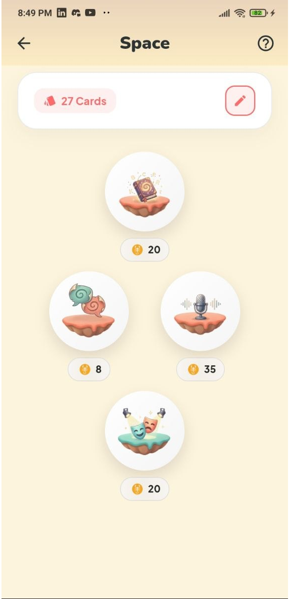 | 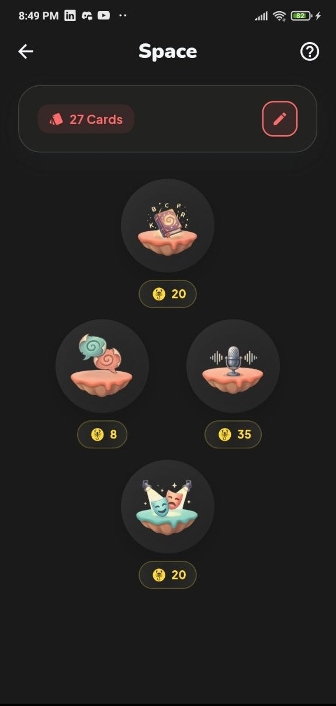 |

#### UX & Design Flow
- Displays the four specialized learning modules for a given unit or topic:
  1. **Word Smith**: Interactive vocabulary retention and flashcard practice.
  2. **Story Weaver**: Immersive narrative reading with contextual visual artwork.
  3. **Echo Chamber**: Audio-first listening comprehension with speech repetition.
  4. **Role Master**: Scenario-based dynamic dialogue.
- Visual difficulty badges, coin costs, and completion status icons.

#### Technical Details
- Integrates with `AI/main.py` routing endpoints.
- Verifies user coin balance via `CoinService` before unlocking exercises.

---

### 2.3 Interactive Story Reader (Story Weaver)
- **File**: `Frontend/badya_app/lib/story_page.dart`

| Light Mode | Dark Mode |
|---|---|
|  | 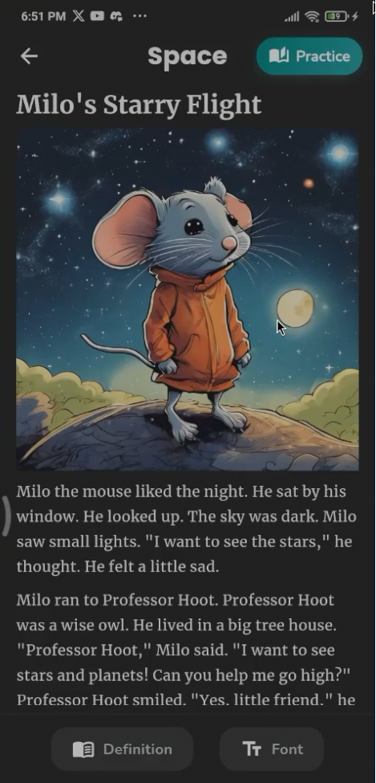 |

#### UX & Design Flow
- **Live Streamed Storytelling**: The narrative streams progressively from the `story_agent` backend using Server-Sent Events (SSE).
- **Contextual Visuals**: Dynamically displays generative illustrations corresponding to storyline milestones.
- **Tap-to-Define**: Users can tap or select any word to instantly reveal a popup definition modal with audio pronunciation.
- **Reader Controls**: Customizable font scale, font typography, theme palette, and brightness modes.
- **Drawer Assistant**: Slide-out assistant for asking clarifying questions about the plot or grammar without leaving the story.

#### Technical Details
- **Backend Agent**: `AI/story_agent/` utilizing Gemini and Stability AI tools.
- **Networking**: Real-time SSE streaming via `AdkService`.
- **Dictionary Lookups**: `AI/definition_agent/` handles contextual disambiguation.

---

### 2.4 Voice Chat & Spoken Role-Play (Role Master & Echo Chamber)
- **File**: `Frontend/badya_app/lib/voice_chat_page.dart`

| Voice Interface | With Transcription| Parallel Assistant |
|---|---|---|
|  | 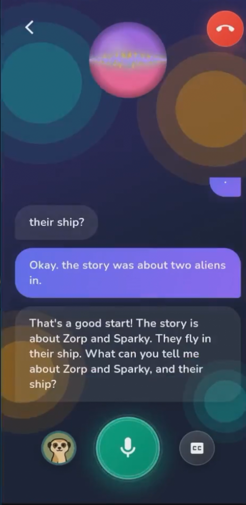 | 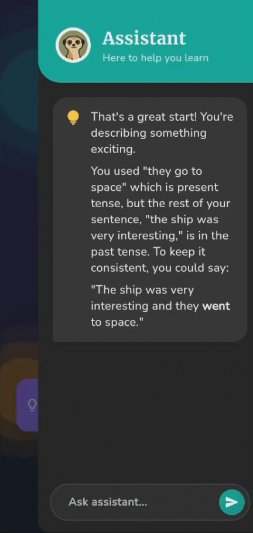 |

#### UX & Design Flow
- **Immersive Voice Interface**: High-fidelity visualizer with audio pulsing orbs reflecting volume and speaking state.
- **Real-Time Captions**: Live speech transcription with a toggleable subtitle transcript.
- **Parallel Corrector Drawer**: A discreet slide-out assistant that provides grammar and vocabulary suggestions in real time without interrupting spoken immersion.

#### Technical Details
- **Backend Services**: `AI/voice_chat/`, `AI/role_master_agent/`, `AI/video_agent/`.
- **Transport**: Full-duplex WebSocket audio streaming (`voiceclient.py` and `VoiceService`).
- **Correction Loop**: Background `corrector_agent` analyzes user utterances asynchronously.

---

### 2.5 Text Chat & Grammar Practice
- **File**: `Frontend/badya_app/lib/chat_page.dart`

| Chat Page |
|---|
| 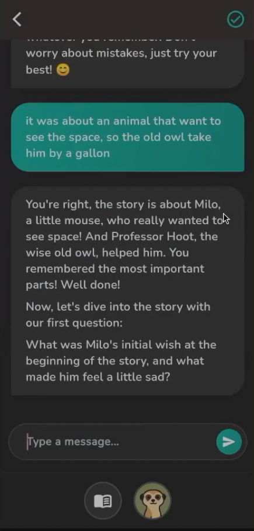 |

#### UX & Design Flow
- Conversational chat interface with message bubbles, speech inputs, and quick reply suggestions.
- Embedded error highlighting: grammatically incorrect phrases are subtly underlined; tapping reveals suggested revisions and explanations.

#### Technical Details
- Backed by `AI/text_chat/` and `AI/corrector_agent/`.
- Session state persisted to Firestore for continuous dialogue history.

---

### 2.6 Vocabulary Management & Spaced Repetition (Strange Words & Topic Words)
- **Files**: `Frontend/badya_app/lib/strange_words_page.dart`, `Frontend/badya_app/lib/topic_words_page.dart`

| User's Cards | Topic's Cards (Dark) | Unscramble Game |
|---|---|---|
| 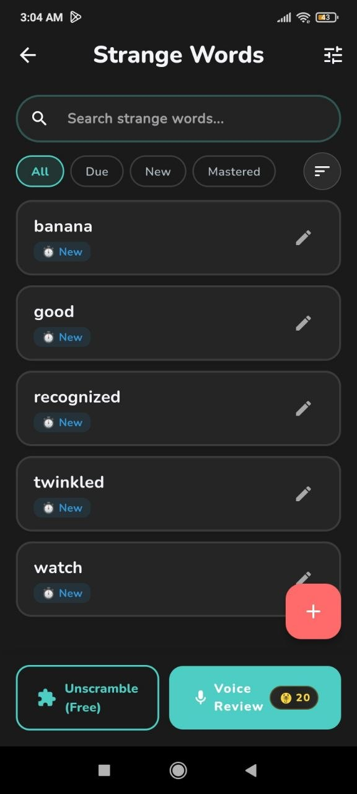 | 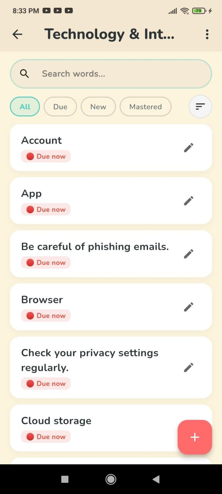 | 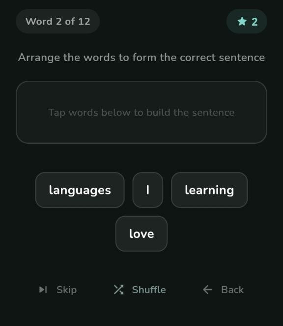 |

#### UX & Design Flow
- **Word List View**: Displays vocabulary terms with difficulty tags and next-review badges (Mastered, Due Now, In N Days).
- **Bulk Actions**: Add words manually, bulk import from text, or mark as learned.
- **Interactive Review (Word Smith)**: Card swipe interface and word unscrambling drills.
- **SRS Filter Bar**: Filter words by urgency (`Due`, `New`, `Mastered`).

#### Technical Details
- **Algorithm**: SuperMemo SM-2 (`models/word_review_state.dart`).
- **Scheduling**: Tracks review repetitions, easiness factors (EF), and optimal review intervals.

---

### 2.7 Library & Content Import
- **Files**: `Frontend/badya_app/lib/library_page.dart`, `Frontend/badya_app/lib/import_course_page.dart`

| Library (Dark) | Import Menu |
|---|---|
|  | 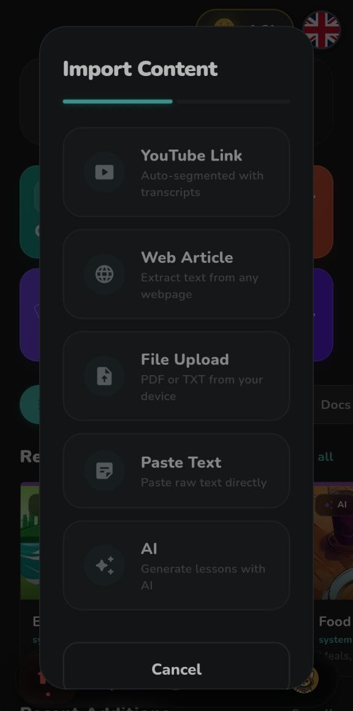 |

| Imported Video | Video Player |
|---|---|
| 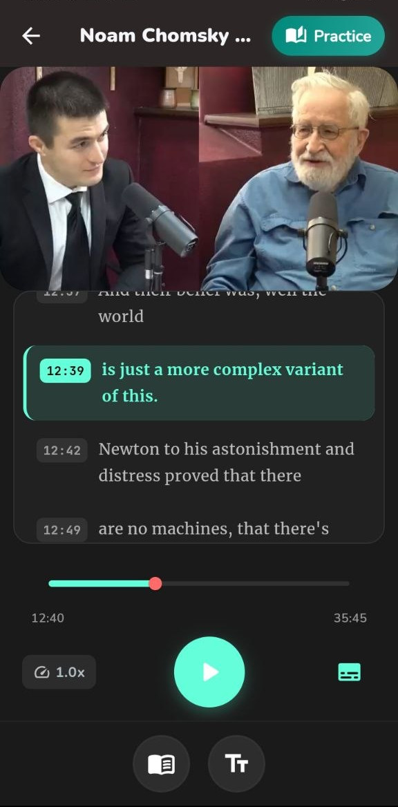 | 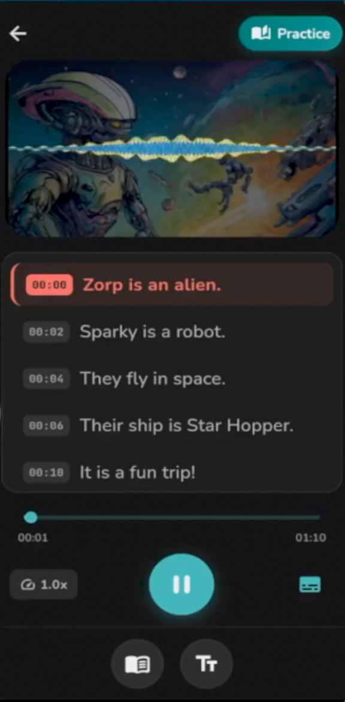 |

#### UX & Design Flow
- **Explore & Discover**: Browse community content by topic tags, CEFR difficulty (A1–C2), and format (video vs text).
- **Import Modal**: Paste web article URLs or YouTube video links to convert them into customized lessons.
- **Segmentation View**: Displays chapters, auto-generated transcripts, and key vocabulary extracted from the imported media.

#### Technical Details
- **Backend Service**: `AI/importer/` (scrapes HTML with `url_extractor.py`, extracts YouTube subtitles with `youtube.py`).
- **Processing**: Breaks media into digestible segments and extracts candidate vocabulary words.

---

### 2.8 Performance Analysis & Lesson Completion
- **File**: `Frontend/badya_app/lib/lesson_completion_page.dart`

#### UX & Design Flow
- **Multi-Metric Scorecard**: Radial gauges indicating Comprehension, Fluency/Expression, and Vocabulary accuracy.
- **Earned Rewards**: Coin bonuses, XP gain, and streak milestone progress.
- **Detailed Insights**: Specific phrases spoken or written that showed notable improvement or require review.

#### Technical Details
- **Backend Agent**: `AI/analyze_agent/` processes complete session logs and outputs structured evaluation metrics.
- Automatically adjusts user SM-2 weights in Firestore.

---

## 3. Data Flow & State Summary

| Layer | Technology | Primary Function |
|---|---|---|
| **Client UI** | Flutter (Dart 3.x) | Cross-platform presentation & audio capture |
| **Authentication** | Firebase Auth | Secure user sign-in & session token generation |
| **Database** | Cloud Firestore | User profiles, vocabulary states, progress, content items |
| **Media Storage** | Firebase Storage | Voice recordings, imported media assets, cached thumbnails |
| **AI Orchestration** | FastAPI + Google ADK | Multi-agent coordination, prompt templates, and streaming |
| **Language Intelligence**| Google Gemini | Agent reasoning, story generation, role-play dialogues |
